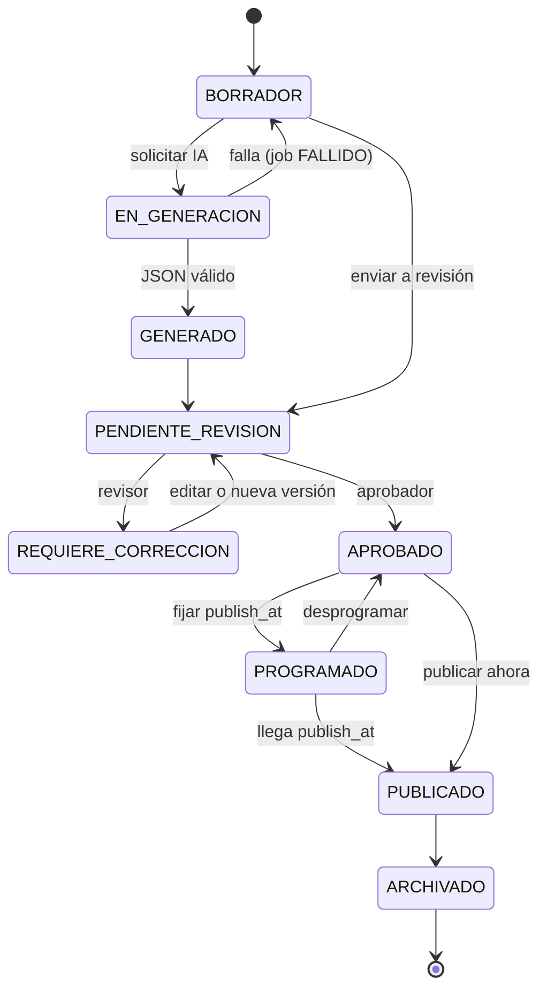
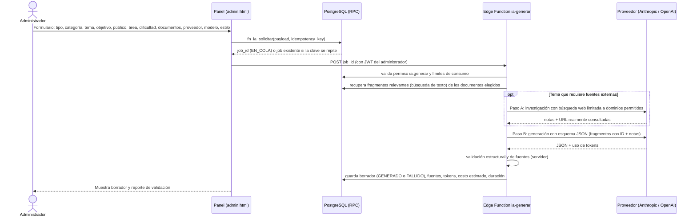
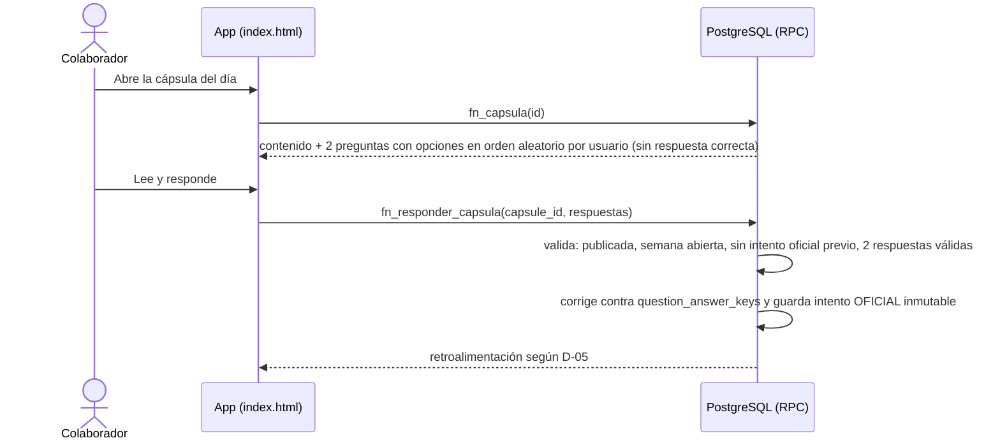
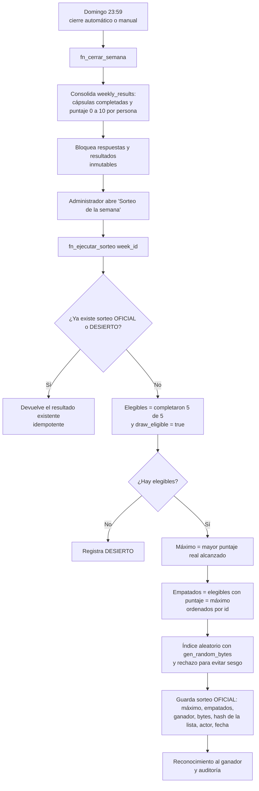
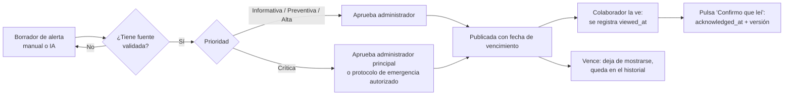

# TRANSPORTES 360 — Mapa funcional (Fase 1)

| Campo | Valor |
|---|---|
| Fecha | 2026-11-20 |
| Concepto | Aprende · Cuídate · Protégete · Crece |
| Estado | Propuesta. Las decisiones marcadas **D-xx** se listan en [PLAN_IMPLEMENTACION.md](PLAN_IMPLEMENTACION.md) §3 |
| Zona horaria | `America/Costa_Rica` (UTC−6, sin horario de verano) |

---

## 1. Tipos de usuario

| Rol | Quién | Cómo ingresa (propuesta D-02) |
|---|---|---|
| **Colaborador** | Choferes, ayudantes, personal operativo | Código de empleado + contraseña personal, definida al activar la cuenta con un código de un solo uso |
| **Supervisor** | Jefaturas de área o de ruta | Correo + contraseña (o Microsoft 365 si se configura) |
| **Administrador** | Gestores de contenido y capacitación | Correo + contraseña / Microsoft 365 |
| **Administrador principal** | Responsable de la plataforma | Correo + contraseña / Microsoft 365, con verificación en dos pasos si el plan lo permite |

Un usuario tiene **un** rol. Los permisos se asignan al rol (tabla `role_permissions`) y se validan en el servidor.

## 2. Matriz de permisos

✔ = permitido · ◐ = limitado al alcance indicado · — = no permitido

| Permiso (código) | Colaborador | Supervisor | Administrador | Adm. principal |
|---|---|---|---|---|
| `contenido.ver_publicado` | ✔ | ✔ | ✔ | ✔ |
| `evaluacion.responder` | ✔ | ✔ (si participa) | — (D-07) | — (D-07) |
| `resultados.ver_propios` | ✔ | ✔ | ✔ | ✔ |
| `alerta.confirmar_lectura` | ✔ | ✔ | ✔ | ✔ |
| `equipo.ver_participacion` | — | ◐ su equipo | ✔ | ✔ |
| `equipo.ver_puntajes` | — | — (D-09 aprobada: solo participación y promedios) | ✔ | ✔ |
| `contenido.crear_editar` | — | — | ✔ | ✔ |
| `ia.generar` | — | — | ✔ | ✔ |
| `contenido.aprobar` | — | — | ✔ (no su propio borrador, ver §6) | ✔ |
| `alerta.aprobar_critica` | — | — | — | ✔ |
| `documentos.gestionar` | — | — | ✔ | ✔ |
| `fuentes.validar` | — | — | ✔ | ✔ |
| `campanas.gestionar` | — | — | ✔ | ✔ |
| `semana.cerrar` | — | — | ✔ | ✔ |
| `sorteo.ejecutar` | — | — | ✔ | ✔ |
| `sorteo.anular` | — | — | — | ✔ |
| `reportes.ver` | — | ◐ su equipo | ✔ | ✔ |
| `usuarios.gestionar` | — | ◐ restablecer acceso de su equipo | ✔ (sin crear administradores) | ✔ |
| `ia.configurar_proveedores` | — | — | — | ✔ |
| `config.parametros` | — | — | — | ✔ |
| `auditoria.ver` | — | — | ◐ su actividad | ✔ |

## 3. Módulos y pantallas

### 3.1 Aplicación del colaborador (`index.html`, móvil primero)

| Pantalla | Contenido |
|---|---|
| **Inicio** | Imagen de flotilla + identidad T360 · tarjeta "Cápsula de hoy" (día x de 5) · progreso semanal (cápsulas completadas, sin mostrar puntaje si D-05 = al cierre) · alertas pendientes de confirmar · consejo del día · categorías · reconocimientos recientes |
| **Cápsula** | Lectura (≤ 5 min) → dos preguntas → envío → retroalimentación según D-05 |
| **Semana** | Las 5 cápsulas con estado: bloqueada / disponible / completada |
| **ALERTAS 360** | Lista por prioridad. Detalle con riesgo, recomendaciones, fuente y botón "Confirmo que leí" |
| **Consejos** | Tarjetas de 30–60 s con botón "Compartir por WhatsApp" |
| **Campañas** | Campañas activas y su contenido |
| **Mi historial** | Semanas, puntaje por semana, cápsulas completadas, alertas confirmadas |
| **Reconocimientos** | Ganadores del sorteo (con consentimiento), insignias personales (semana perfecta, racha de semanas completas) |
| **Perfil** | Nombre, área, cambio de contraseña, cerrar sesión, aviso de privacidad |

Navegación inferior de 4 botones: **Inicio · Semana · Alertas · Mi historial**. El resto se abre desde Inicio.

### 3.2 Panel administrativo (`admin.html`, escritorio primero, usable en tableta)

Contenido (semanas, cápsulas, consejos, alertas, campañas) · Generador IA · Revisión y aprobación · Calendario editorial · Biblioteca documental · Fuentes externas · Usuarios y áreas · Cierre de semana y sorteo · Reportes · Proveedores de IA y consumo · Parámetros · Auditoría.

## 4. Estados editoriales

Mismos estados para semanas de capacitación, consejos, alertas y campañas.

Reglas:

- Solo `APROBADO`, `PROGRAMADO` y `PUBLICADO` son visibles para los colaboradores, y solo si `publish_at <= now()` y no ha vencido. La visibilidad se calcula en la consulta, sin depender de una tarea programada.
- Cualquier edición de contenido `APROBADO` o `PROGRAMADO` lo devuelve a `PENDIENTE_REVISION` y crea una versión nueva.
- Una cápsula `PUBLICADO` con respuestas oficiales **no se edita**; ver §8.5.

## 5. Flujo de generación con IA

El administrador ve el progreso por el estado del *job*. Ninguna salida de la IA se publica sin pasar por §6.

## 6. Flujo de revisión y aprobación

1. El borrador llega a `PENDIENTE_REVISION` con su **reporte de validación** (estructura, fuentes no verificadas, conflictos entre documentos, temas sensibles).
2. El revisor completa la **lista de verificación** según la categoría (por ejemplo, Salud: "no diagnostica, no receta, remite a un profesional").
3. Decisión: `APROBAR`, `SOLICITAR_CORRECCION` (con comentario) o editar a mano (crea una versión nueva).
4. **Cuatro ojos**: quien solicitó o editó el borrador no puede aprobarlo. Si solo hay un administrador, aprueba el administrador principal. *(Propuesta; confirmar en Fase 2.)*
5. Alertas `CRITICA`: aprobación obligatoria del administrador principal.
6. Queda en `approval_history`: actor, fecha, versión, decisión, comentario y lista de verificación.

## 7. Flujo de publicación

- **Programada**: el aprobador fija `publish_at`. Para una semana, las 5 cápsulas se habilitan una por día (lunes 00:00 → cápsula 1, …, viernes 00:00 → cápsula 5).
- **Inmediata**: `publish_at = now()`.
- Una tarea programada (`pg_cron`) marca `PUBLICADO` lo que ya es visible y `ARCHIVADO` lo vencido. Es solo para reportes: la visibilidad no depende de ella.
- La publicación **nunca** toma contenido que no esté `APROBADO`.

## 8. Flujo de evaluación

### 8.1 Disponibilidad

Cada cápsula está disponible desde su día hasta el **cierre de la semana** (propuesta D-06: domingo 23:59). Así, quien está en ruta puede ponerse al día sin perder la elegibilidad.

### 8.2 Recomendación sobre la política de intentos (D-04)

| Opción | Ventaja | Desventaja |
|---|---|---|
| **A. Primer intento oficial + prácticas ilimitadas que no cuentan** *(recomendada)* | Equidad: todos tienen una oportunidad. Fácil de explicar. Permite aprender después de equivocarse | La práctica revela la respuesta correcta, que puede compartirse (riesgo R-66, ya aceptado) |
| B. Un solo intento, sin práctica | Lo más simple | Se pierde el aprendizaje del error |
| C. Varios intentos oficiales, cuenta el mejor | Menos frustración | Premia la prueba y error: todos llegan a 10 y la evaluación deja de medir comprensión |
| D. Varios intentos, cuenta el promedio | Intermedia | Difícil de explicar y de auditar |

Detalles de la opción A:

- El intento **oficial** es el primero que se **envía**. Abrir la cápsula no cuenta.
- Si falla la red durante el envío, el reintento lleva la misma clave de idempotencia: no se crea un segundo intento.
- La política queda en `app_settings` (`attempt_policy`) para poder cambiarla, pero **solo para semanas futuras**: una semana abierta conserva la regla con la que empezó.

### 8.3 Retroalimentación (D-05)

- **Recomendado: inmediata** después del intento oficial (correcta o incorrecta + explicación). Es lo que más enseña, y el intento ya quedó cerrado.
- Alternativa: correcta/incorrecta inmediata y explicación completa al cierre de la semana. Reduce un poco el intercambio de respuestas, a costa de aprender menos.

### 8.4 Puntuación

1 punto por respuesta correcta · 2 por cápsula · 10 por semana. Solo cuentan las 10 preguntas de la capacitación semanal. Alertas, consejos y campañas **no** suman puntos.

### 8.5 Corrección de una pregunta defectuosa

Si una pregunta resulta ambigua después de publicada, el administrador principal ejecuta `fn_corregir_pregunta` **antes del cierre**: anula la pregunta para todos (cuenta como correcta para todos los que la respondieron, o se excluye del máximo). Queda auditado con su motivo. Después del cierre, ver §9.4.

## 9. Flujo del cierre semanal y del sorteo

### 9.1 Reglas exactas

1. **Participan** solo quienes completaron las 5 evaluaciones oficiales de la semana.
2. **Máximo** = mayor puntaje realmente alcanzado entre ellos. No hay mínimo fijo: si el máximo es 7, participan todos los que tienen 7.
3. **Empates**: todos con la misma probabilidad. Sin criterio de velocidad ni de orden.
4. **Un único ganador** y **una única instancia oficial** por semana.
5. Excluidos: usuarios inactivos al cierre y roles con acceso a las respuestas (D-07).

### 9.2 Algoritmo (servidor)

- `n` = cantidad de empatados, ordenados por `user_id`.
- Se toman 4 bytes de `gen_random_bytes` → entero `r` entre 0 y 2³²−1. Si `r ≥ floor(2³² / n) · n`, se descarta y se repite (sin sesgo de módulo).
- Ganador = posición `r mod n`.
- Se guardan los bytes usados, `n`, la lista ordenada y su SHA-256: cualquiera puede verificar después que el ganador corresponde a esos datos.

### 9.3 Controles

- Índice único parcial: un sorteo `OFICIAL` o `DESIERTO` por semana.
- `SELECT ... FOR UPDATE` sobre la semana durante la ejecución (evita la carrera entre dos administradores).
- Exige la semana `CERRADA`.
- Triggers de inmutabilidad en `weekly_draws`, `draw_entries` y `weekly_results`.

### 9.4 Corrección después del cierre (procedimiento auditado)

Solo el administrador principal, con motivo escrito:

1. `fn_anular_sorteo(draw_id, motivo)` → el sorteo pasa a `ANULADO` (no se borra).
2. Corrección de los datos origen mediante una función específica que deja la versión anterior en auditoría.
3. Nuevo sorteo con `replaces_draw_id` apuntando al anulado.

El historial muestra ambos sorteos. Así se cumple "una sola instancia oficial" sin ocultar la corrección.

## 10. Flujo de ALERTAS 360

- Tres estados por persona: **publicada** (existe para su audiencia) → **vista** (abrió el detalle, evidencia técnica) → **confirmada** (pulsó el botón dentro de la aplicación).
- Si la alerta cambia de contenido, se crea una **versión nueva** y la confirmación anterior no cuenta para la nueva.
- Recibir un enlace por WhatsApp **no** es lectura.

## 11. Flujo de campañas

1. El administrador crea la campaña (nombre, categoría, fechas de inicio y fin).
2. Asocia elementos existentes o nuevos: semanas de capacitación, consejos y alertas (`campaign_items`).
3. Cada elemento conserva su propio flujo de aprobación y publicación. La campaña solo agrupa y da visibilidad.
4. La campaña no suma puntos ni altera el sorteo. Si incluye una semana de capacitación, esa semana se rige por sus propias reglas.

## 12. Consejos breves

Contenido de 30 a 60 segundos (≤ 600 caracteres), sin evaluación. Flujo editorial simplificado (un solo aprobador). Botón **Compartir** que abre `https://wa.me/?text=<mensaje corto + enlace>`; el enlace lleva a la aplicación y, si no hay sesión, al ingreso y después al consejo.

## 13. Calendario editorial

- Vista de 8 semanas hacia adelante con la categoría planificada por semana y alerta de repetición (el mismo tema en los últimos N meses).
- Rotación por defecto configurable (por ejemplo: Finanzas → Seguridad → Salud → Seguridad digital).
- Sugerencias de temas: la IA recibe los temas impartidos (vista `topic_history`), las preguntas con más errores y las campañas próximas. Solo **propone**: el administrador decide.

## 14. Reportes (definiciones)

Toda métrica muestra su numerador y su denominador.

| Indicador | Definición |
|---|---|
| Colaboradores activos | `profiles` con rol Colaborador y `is_active` en la fecha |
| Ingresaron en la semana | Activos con al menos una sesión o una vista registrada en la semana |
| Participación semanal | Activos con ≥ 1 intento oficial ÷ activos |
| Finalización semanal | Activos con 5 de 5 intentos oficiales ÷ activos |
| Puntaje promedio | Promedio de `weekly_results.score` entre quienes completaron 5 de 5 |
| % de aciertos por pregunta | Respuestas oficiales correctas ÷ respuestas oficiales de esa pregunta |
| Confirmación de alerta | Confirmaciones de la versión vigente ÷ audiencia de la alerta |
| Aprobación de contenido IA | Borradores generados que llegaron a `APROBADO` ÷ borradores generados |
| Costo IA | Suma de `estimated_cost_usd` (estimado con los precios registrados, no la factura real) |
