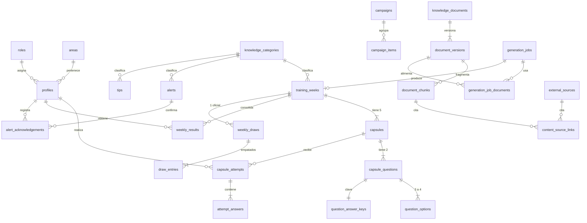

# TRANSPORTES 360 — Modelo de datos propuesto (Fase 1)

| Campo | Valor |
|---|---|
| Fecha | 2026-11-20 |
| Estado | **Propuesta conceptual. No se ha creado nada.** Requiere aprobación en Fase 2 |
| Motor | Supabase PostgreSQL, proyecto dedicado `TRANSPORTES-360` (D-01) |
| Convención | Tablas y columnas en inglés `snake_case`, como la lista del prompt maestro (D-03). Interfaz y mensajes en español |

---

## 1. Tablas existentes

**Ninguna conocida.** El proyecto `TRANSPORTES-360` es recién creado y se espera vacío, pero **falta confirmarlo** con las consultas de PLAN_IMPLEMENTACION §2. Si aparecen tablas, funciones o políticas creadas a mano, se inventarían aquí antes de proponer cualquier migración, para no duplicarlas ni reemplazarlas.

## 2. Ajustes a la lista conceptual del prompt maestro

| Entidad del prompt | Decisión | Motivo |
|---|---|---|
| `training_weeks`, `capsules`, `capsule_questions` | Se mantienen | Núcleo del programa |
| — | **Nuevas:** `question_options`, `question_answer_keys` | Opciones con identificador estable y respuesta correcta **separada**, para que RLS impida verla (R-02) |
| `daily_participations` | Se llama `capsule_attempts` + `attempt_answers` | Separar el intento de cada respuesta permite medir los errores por pregunta |
| `weekly_scores` | Se llama `weekly_results` y se **materializa al cierre** | Antes del cierre se calcula con una vista; al cerrar queda congelada e inmutable |
| `weekly_draws`, `draw_entries` | Se mantienen | El sorteo depende de la semana, no de la cápsula |
| `topic_history` | **Vista**, no tabla | Se deriva de `training_weeks`: una tabla aparte se desincronizaría |
| `content_reviews` + `approval_history` | **Fusionadas** en `approval_history` | Registran el mismo hecho (decisión sobre una versión). Dos tablas duplicarían la información |
| `generation_sources` | Se generaliza como `content_source_links` | Las fuentes se asocian a cápsulas, alertas y consejos, generados o no |
| — | **Nuevas:** `profiles`, `roles`, `permissions`, `role_permissions`, `areas`, `account_activations` | Identidad y permisos (no estaban en la lista) |
| — | **Nuevas:** `document_versions`, `trusted_domains`, `ai_models`, `generation_job_documents`, `content_versions`, `tips`, `recognitions`, `capsule_views`, `app_settings` | Justificadas en cada sección |

## 3. Diagrama entidad-relación (núcleo)



## 4. Esquemas

| Esquema | Uso | Expuesto en la API |
|---|---|---|
| `public` | Tablas con RLS y funciones RPC que llama el frontend | Sí |
| `app` | Funciones internas de seguridad, cálculo y triggers (patrón ArreoPrime) | **No** |
| `reporting` | Vistas de indicadores para el panel | Sí, con funciones que validan el permiso |

## 5. Tablas propuestas

Convenciones comunes (no se repiten en cada tabla):

- `id uuid primary key default gen_random_uuid()` salvo que se indique otra cosa.
- `created_at timestamptz not null default now()`, `created_by uuid references profiles(id)`, `updated_at` con el trigger `app.tg_updated_at`.
- **Bloque editorial** (en `training_weeks`, `tips`, `alerts`, `campaigns`): `status content_status not null default 'BORRADOR'`, `version int not null default 1`, `approved_by uuid`, `approved_at timestamptz`, `publish_at timestamptz`, `published_at timestamptz`, `archived_at timestamptz`, `generation_job_id uuid references generation_jobs(id)`.
- Tipo `content_status`: `BORRADOR, EN_GENERACION, GENERADO, PENDIENTE_REVISION, REQUIERE_CORRECCION, APROBADO, PROGRAMADO, PUBLICADO, ARCHIVADO`.

### 5.1 Identidad y permisos

**`roles`** — `id text pk` (`COLABORADOR`, `SUPERVISOR`, `ADMIN`, `ADMIN_PRINCIPAL`), `name`, `sort_order`.

**`permissions`** — `id text pk` (por ejemplo `evaluacion.responder`), `description`.

**`role_permissions`** — `role_id fk`, `permission_id fk`, **pk (role_id, permission_id)**.

**`areas`** — `id text pk`, `name`, `is_active`.

**`profiles`**

| Columna | Tipo | Restricción |
|---|---|---|
| `id` | uuid | pk, fk → `auth.users(id)` `on delete restrict` |
| `employee_code` | text | `unique`, not null para colaboradores, `check (employee_code ~ '^[A-Z0-9-]{2,20}$')` |
| `full_name` | text | not null, ≥ 3 caracteres |
| `role_id` | text | fk → `roles` |
| `area_id` | text | fk → `areas` |
| `supervisor_id` | uuid | fk → `profiles`, null |
| `email` | text | null (colaboradores pueden no tenerlo), `unique` cuando existe |
| `is_active` | boolean | default false (se activa con el código de activación) |
| `draw_eligible` | boolean | calculado por trigger: false si el rol tiene `contenido.crear_editar` (D-07) |
| `privacy_accepted_at` | timestamptz | null hasta aceptar el aviso |
| `deactivated_at` | timestamptz | null |

Índices: `(role_id) where is_active`, `(area_id)`, `(supervisor_id)`.

**`account_activations`** — `profile_id fk`, `code_hash text not null` (SHA-256 con sal, nunca el código en claro), `expires_at` (default `now() + 72 h`), `used_at`, `failed_attempts smallint default 0 check (≤ 5)`, `issued_by fk`. Índice único parcial: una activación vigente por perfil `where used_at is null`.

### 5.2 Catálogos

**`knowledge_categories`** — `slug text unique`, `name`, `description`, `icon`, `color_token`, `sort_order int`, `is_active bool`. Las 6 categorías iniciales se cargan como datos, no se escriben en el frontend.

**`topic_catalog`** — `category_id fk`, `title`, `description`, `tags text[]`, `is_active`. Índice `unique (category_id, lower(title))`.

**Vista `topic_history`** — semanas publicadas con categoría, tema, fechas, participación y % de aciertos.

### 5.3 Capacitación semanal

**`training_weeks`** (+ bloque editorial)

| Columna | Tipo | Restricción |
|---|---|---|
| `week_start` | date | not null, `check (extract(isodow from week_start) = 1)` (lunes) |
| `week_end` | date | generada: `week_start + 6` |
| `category_id` | uuid | fk |
| `topic_id` | uuid | fk null |
| `title`, `objective` | text | not null |
| `schema_version` | text | versión del esquema JSON con que se generó |
| `attempt_policy` | jsonb | copia de la política vigente al publicar (D-04) |
| `closed_at`, `closed_by` | | null hasta el cierre |

Índice **único parcial** `(week_start) where status not in ('ARCHIVADO')`: una sola capacitación activa por semana.

**`capsules`**

| Columna | Tipo | Restricción |
|---|---|---|
| `week_id` | uuid | fk → `training_weeks` `on delete restrict` |
| `day_number` | smallint | `check (day_number between 1 and 5)` |
| `title`, `objective`, `introduction`, `body`, `example`, `closing_message` | text | not null, no vacíos |
| `recommendations` | jsonb | arreglo de textos, `check (jsonb_array_length(...) between 2 and 6)` |
| `estimated_minutes` | smallint | `check (between 1 and 10)` |
| `visual_proposal` | jsonb | `{type, description}` |
| `available_from` | date | generada: `week_start + day_number − 1` (vía trigger) |
| `locked_at` | timestamptz | se fija con la primera respuesta oficial |

**`unique (week_id, day_number)`**. Así caben exactamente 5 cápsulas por semana: una restricción `unique (week_id)` lo impediría.

**`capsule_blocks`** *(agregada en Fase 2, ver FASE2_DISENO §4.4 y §5)* — `capsule_id fk`, `position smallint`, `block_type text check in ('portada','escenario','revelar','detecta','historia','infografia','compromiso','evaluacion')`, `data jsonb not null`, `asset_id uuid null fk → generated_assets`, `alt_text text` (obligatorio cuando el bloque tiene imagen). **`unique (capsule_id, position)`**. Se bloquea junto con la cápsula (`locked_at`).

**`capsule_questions`** — `capsule_id fk`, `position smallint check (1..2)`, `prompt text not null`. **`unique (capsule_id, position)`**.

**`question_options`** — `question_id fk`, `position smallint check (1..4)`, `label text not null`. `unique (question_id, position)` y `unique (question_id, id)` (necesaria para la FK compuesta).

**`question_answer_keys`** — `question_id pk fk`, `correct_option_id uuid not null`, `explanation text not null`, `incorrect_feedback text not null`. **FK compuesta `(question_id, correct_option_id) → question_options(question_id, id)`**: la opción correcta pertenece a la misma pregunta. Una fila por pregunta = **una sola respuesta correcta**.

**Regla "5 cápsulas × 2 preguntas × 3–4 opciones × 1 clave"**: no se puede expresar con restricciones de fila. La verifica `app.validar_semana_completa(week_id)`, que se ejecuta obligatoriamente en `fn_aprobar` y en `fn_programar`. No se puede aprobar una semana incompleta.

**Bloqueo**: un trigger rechaza `update`/`delete` sobre cápsulas, preguntas, opciones y claves cuya cápsula tenga `locked_at`. La única vía de corrección es `fn_corregir_pregunta` (MAPA §8.5).

### 5.4 Participación y resultados

**`capsule_views`** — `capsule_id`, `user_id`, `first_viewed_at`. pk `(capsule_id, user_id)`. Evidencia técnica de lectura.

**`capsule_attempts`**

| Columna | Tipo | Restricción |
|---|---|---|
| `capsule_id`, `week_id`, `user_id` | uuid | fk |
| `attempt_type` | text | `check in ('OFICIAL','PRACTICA')` |
| `score` | smallint | `check (between 0 and 2)` |
| `submitted_at` | timestamptz | default `now()` |
| `idempotency_key` | uuid | `unique` |
| `option_order` | jsonb | orden en que se mostraron las opciones (auditoría) |

Índice **único parcial** `(capsule_id, user_id) where attempt_type = 'OFICIAL'`: **un solo intento oficial**. Índice `(week_id, user_id)`. Inmutable por trigger.

**`attempt_answers`** — `attempt_id fk`, `question_id fk`, `selected_option_id`, `is_correct bool`. pk `(attempt_id, question_id)`. FK compuesta a `question_options(question_id, id)`. Inmutable.

**Vista `v_weekly_progress`** — antes del cierre: cápsulas completadas y puntaje por persona (solo filas propias para colaboradores).

**`weekly_results`** (se escribe solo en `fn_cerrar_semana`)

| Columna | Tipo | Restricción |
|---|---|---|
| `week_id`, `user_id` | uuid | **pk (week_id, user_id)** |
| `capsules_completed` | smallint | `check (between 0 and 5)` |
| `score` | smallint | `check (between 0 and 10)` |
| `completed_all` | boolean | `= (capsules_completed = 5)` |
| `computed_at` | timestamptz | |

Inmutable por trigger.

**`weekly_draws`**

| Columna | Tipo | Restricción |
|---|---|---|
| `week_id` | uuid | fk |
| `status` | text | `check in ('OFICIAL','DESIERTO','ANULADO')` |
| `max_score` | smallint | null si está desierto |
| `eligible_count` | int | |
| `winner_user_id` | uuid | fk null |
| `random_bytes` | bytea | bytes usados |
| `eligible_list_sha256` | text | hash de la lista ordenada |
| `algorithm_version` | text | por ejemplo `v1-rejection-u32` |
| `executed_by`, `executed_at` | | not null |
| `annulled_by`, `annulled_at`, `annul_reason` | | solo si `ANULADO` |
| `replaces_draw_id` | uuid | fk → `weekly_draws`, null |

Índice **único parcial** `(week_id) where status in ('OFICIAL','DESIERTO')`. Trigger: solo se permite el cambio `OFICIAL → ANULADO` con motivo; nada más se modifica.

**`draw_entries`** — `draw_id fk`, `user_id fk`, `score`, `position int` (orden por `user_id`). pk `(draw_id, user_id)`. Inmutable.

**`recognitions`** — `user_id`, `week_id null`, `type check in ('GANADOR_SORTEO','SEMANA_PERFECTA','RACHA')`, `public_consent bool`. `unique (user_id, week_id, type)`.

### 5.5 Alertas, consejos y campañas

**`alerts`** (+ bloque editorial) — `category_id`, `priority check in ('INFORMATIVA','PREVENTIVA','ALTA','CRITICA')`, `title`, `description`, `identified_risk`, `recommendations jsonb`, `requires_ack bool default true`, `expires_at timestamptz not null check (expires_at > publish_at)`, `emergency_protocol bool default false`, `audience jsonb` (todas las áreas o una lista). Índice `(status, publish_at, expires_at)`.

**`alert_acknowledgements`** — `alert_id`, `user_id`, `alert_version int`, `viewed_at`, `acknowledged_at`. **pk (alert_id, user_id, alert_version)**.

**`tips`** (+ bloque editorial) — `category_id`, `title`, `body text check (char_length(body) <= 600)`, `share_text text check (<= 300)`, `expires_at null`.

**`campaigns`** (+ bloque editorial) — `name`, `description`, `category_id null`, `starts_on date`, `ends_on date check (ends_on >= starts_on)`.

**`campaign_items`** — `campaign_id fk`, `week_id`, `tip_id`, `alert_id` (fk, null), `sort_order`. `check (num_nonnulls(week_id, tip_id, alert_id) = 1)`. Con esto las FK son reales, sin una referencia polimórfica sin integridad.

### 5.6 Biblioteca documental

**`knowledge_documents`** — `title`, `category_id`, `description`, `doc_type check in ('PROCEDIMIENTO','POLITICA','MANUAL','REGLAMENTO','GUIA','INTERNO','CAPACITACION','OTRO')`, `access_level check in ('COLABORADORES','ADMIN','RESTRINGIDO')`, `origin`, `owner_id`, `status check in ('ACTIVO','ARCHIVADO','OBSOLETO')`, `valid_from`, `valid_until`, `is_temporary bool`, `purge_after timestamptz` (temporales), `current_version_id`, `ai_allowed bool` (false por defecto si es `RESTRINGIDO`).

**`document_versions`** — `document_id fk`, `version_label`, `storage_path`, `mime_type check in (pdf, docx, xlsx, pptx, txt)`, `size_bytes check (<= 25 MB)`, `sha256 text`, `uploaded_by`, `uploaded_at`, `processing_status check in ('PENDIENTE','PROCESANDO','LISTO','ERROR')`, `page_count`, `is_scanned bool`, `ocr_used bool`, `detected_dates jsonb`, `error`. **`unique (document_id, sha256)`**: el mismo archivo no se reprocesa.

**`document_chunks`** — `document_version_id fk on delete cascade`, `chunk_index`, `page_from`, `page_to`, `section_title`, `content text`, `tsv tsvector generated always as (to_tsvector('spanish', coalesce(section_title,'') || ' ' || content)) stored`, `token_estimate`. Índice **GIN** sobre `tsv`. Columna `embedding vector(n)` **solo si se aprueba pgvector** (D-12).

### 5.7 Fuentes

**`trusted_domains`** — `domain text pk`, `entity_name`, `country`, `reliability check in ('OFICIAL','RECONOCIDA')`, `is_active`. Lista inicial: dominios del Ministerio de Salud, CSO, COSEVI, INS, BCCR, SUGEF, MEIC, OMS, OPS, OIT, CISA e INCIBE, **validados uno por uno por un administrador** (no se cargan desde la memoria de la IA).

**`external_sources`** — `entity_name`, `resource_title`, `url text unique`, `domain fk → trusted_domains null`, `published_on date null`, `consulted_at timestamptz`, `category_id`, `reliability`, `validation_status check in ('PENDIENTE','VALIDADA','RECHAZADA')`, `validated_by`, `validated_at`, `notes`.

**`content_source_links`** — `capsule_id`, `alert_id`, `tip_id` (fk, una sola), `external_source_id` o `document_chunk_id` (fk, una sola), `document_version_id`, `page_or_section`, `excerpt text check (<= 500)`, `consulted_at`, `verified bool` (el servidor comprobó que el fragmento existe y contiene el texto citado). Dos `check (num_nonnulls(...) = 1)`.

### 5.8 Inteligencia artificial

**`ai_providers`** — `id text pk` (`anthropic`, `openai`), `display_name`, `is_enabled`, `secret_name text` (**solo el nombre** del secreto, por ejemplo `ANTHROPIC_API_KEY`; nunca el valor), `connection_status`, `last_check_at`, `last_error`.

**`ai_models`** — `provider_id fk`, `model_id text`, `display_name`, `input_usd_per_mtok numeric`, `output_usd_per_mtok numeric`, `price_checked_at date`, `max_output_tokens int`, `is_enabled`, `is_default`. pk `(provider_id, model_id)`. Los precios se registran a mano desde la página oficial del proveedor, con su fecha.

**`ai_usage_limits`** — `scope check in ('GLOBAL','USUARIO')`, `period check in ('DIA','MES')`, `max_requests`, `max_cost_usd`.

**`generation_jobs`**

| Columna | Tipo | Nota |
|---|---|---|
| `content_type` | text | `weekly_training`, `alert`, `tip`, `campaign_plan`, `topic_suggestions` |
| `request_payload` | jsonb | formulario completo |
| `provider_id`, `model_id` | text | fk → `ai_models` |
| `prompt_version`, `schema_version` | text | |
| `status` | text | `EN_COLA, EN_GENERACION, GENERADO, FALLIDO, CANCELADO` |
| `idempotency_key` | uuid | `unique` (evita duplicar la solicitud) |
| `requested_by` | uuid | |
| `started_at`, `finished_at`, `duration_ms` | | |
| `input_tokens`, `output_tokens`, `cache_read_tokens` | int | lo que informe el proveedor |
| `estimated_cost_usd` | numeric(10,4) | tokens × precio registrado |
| `retry_count` | smallint | `check (<= 2)` |
| `stop_reason`, `error_code`, `error_message` | text | |
| `raw_output` | jsonb | respuesta original, para auditoría |
| `validation_report` | jsonb | errores y advertencias del validador |

Índices `(requested_by, created_at desc)`, `(status)`.

**`generation_job_documents`** — `job_id`, `document_version_id`, `is_temporary`. pk compuesta.

**`generated_assets`** — `capsule_id`, `tip_id`, `alert_id` (una), `asset_type check in ('SVG','INFOGRAFIA','IMAGEN','TARJETA_WHATSAPP')`, `generator` (`HTML_SVG` o el proveedor), `storage_path`, `prompt`, `rights_status check in ('PROPIO','LICENCIADO','PENDIENTE')`.

### 5.9 Historial editorial, notificaciones, parámetros y auditoría

**`approval_history`** — `entity_type check in ('training_week','tip','alert','campaign')`, `entity_id`, `entity_version`, `from_status`, `to_status`, `decision`, `comment`, `checklist jsonb`, `actor_id`, `created_at`. Inmutable. Índice `(entity_type, entity_id, created_at)`. Es polimórfica a propósito: es un registro histórico, y la integridad la garantiza la RPC que escribe.

**`content_versions`** — `entity_type`, `entity_id`, `version`, `snapshot jsonb`, `created_by`, `created_at`. `unique (entity_type, entity_id, version)`. Guarda cada versión completa (lo que generó la IA y cada edición humana).

**`user_notifications`** — `user_id`, `type`, `title`, `body`, `link`, `read_at`. Índice `(user_id, read_at)`.

**`app_settings`** — `key text pk`, `value jsonb`, `updated_by`, `updated_at`. Claves iniciales: `attempt_policy`, `feedback_mode`, `week_close` (`{"isodow":7,"time":"23:59"}`), `ai_enabled`, `draw_exclude_permissions`.

**`audit_logs`** — `id bigint generated always as identity pk`, `ts`, `actor_id`, `action`, `entity_type`, `entity_id`, `details jsonb`. Inmutable. Índices `(ts desc)`, `(entity_type, entity_id)`.

## 6. Storage

| Bucket | Acceso | Contenido |
|---|---|---|
| `documentos` | Privado | Versiones de documentos permanentes. Lectura por URL firmada (5 min) según `access_level` |
| `temporales` | Privado | Adjuntos de una generación. Purga diaria de lo vencido (`purge_after`) |
| `recursos` | Privado; los recursos de contenido publicado se sirven por URL firmada | Infografías, SVG, tarjetas para WhatsApp |

Rutas con prefijo por entidad (`documentos/<document_id>/<version_id>.<ext>`). Las políticas de `storage.objects` validan el permiso con `app.tiene_permiso`.

## 7. Políticas RLS sugeridas

Todas las tablas de `public` con `enable row level security`. Sin política = sin acceso.

| Tabla | SELECT | INSERT / UPDATE / DELETE |
|---|---|---|
| `profiles` | Propia fila; supervisor ve su equipo (`supervisor_id = auth.uid()`); admin ve todas | Solo RPC de administrador |
| `roles`, `permissions`, `areas`, `knowledge_categories` | Autenticados (solo activos) | Solo RPC de administrador |
| `training_weeks`, `capsules`, `capsule_questions`, `question_options` | Colaborador: publicadas y vigentes (`app.es_visible(...)`). Admin: todas | Solo RPC con `contenido.crear_editar` |
| `question_answer_keys` | **Solo** `contenido.crear_editar`. Colaboradores y supervisores **nunca** | Solo RPC |
| `capsule_attempts`, `attempt_answers` | Propias filas; admin con `reportes.ver` | **Solo** `fn_responder_capsula` (security definer). Sin INSERT directo |
| `weekly_results` | Propias filas; supervisor según D-09; admin | Solo `fn_cerrar_semana` |
| `weekly_draws`, `draw_entries` | Colaborador: semana, estado y ganador (si dio su consentimiento); `draw_entries` solo la propia fila. Admin: todo | Solo `fn_ejecutar_sorteo` / `fn_anular_sorteo` |
| `alerts`, `tips`, `campaigns`, `campaign_items` | Publicadas, vigentes y de su audiencia; admin todas | Solo RPC |
| `alert_acknowledgements` | Propias filas; admin y supervisor (su equipo) | Solo `fn_confirmar_alerta` |
| `knowledge_documents`, `document_versions`, `document_chunks` | Según `access_level`. Los chunks, solo admin | Solo admin (RPC / Edge Function) |
| `external_sources`, `trusted_domains`, `content_source_links` | Admin; colaborador solo los vínculos de contenido publicado (para mostrar "Fuente") | Solo admin |
| `ai_providers`, `ai_models`, `ai_usage_limits` | Admin | Solo administrador principal |
| `generation_jobs`, `generation_job_documents`, `generated_assets` | Admin | Edge Function (`service_role`) y RPC |
| `approval_history`, `content_versions`, `audit_logs` | Admin (`auditoria.ver`) | Solo funciones internas; inmutables |
| `user_notifications` | Propias filas | Solo funciones; el usuario solo marca `read_at` vía RPC |
| `app_settings` | Autenticados (claves públicas); admin todas | Solo administrador principal |

Revocar `execute` de las funciones de `app` a `public` y `anon`. El rol `anon` no lee ninguna tabla.

## 8. Funciones RPC previstas (frontend → base de datos)

| Función | Quién | Qué hace |
|---|---|---|
| `fn_mi_perfil()` | Todos | Perfil + permisos efectivos (como ArreoPrime) |
| `fn_inicio()` | Colaborador | Cápsula de hoy, progreso, alertas pendientes, consejo y reconocimientos en una sola llamada (menos datos móviles) |
| `fn_capsula(id)` | Colaborador | Contenido + preguntas con opciones barajadas por usuario, sin respuesta correcta. Registra la vista |
| `fn_responder_capsula(capsule_id, answers, idempotency_key)` | Colaborador | Valida, corrige, guarda el intento oficial o de práctica y devuelve la retroalimentación |
| `fn_mi_historial()` | Colaborador | Semanas, puntajes, alertas confirmadas, reconocimientos |
| `fn_confirmar_alerta(alert_id)` | Todos | Confirma la lectura de la versión vigente |
| `fn_admin_guardar_*`, `fn_enviar_revision`, `fn_aprobar`, `fn_solicitar_correccion`, `fn_programar`, `fn_archivar` | Admin | Flujo editorial con validación y `approval_history` |
| `fn_ia_solicitar(payload, idempotency_key)` | Admin | Crea el *job* tras validar límites |
| `fn_cerrar_semana(week_id)` | Admin / cron | Consolida y congela `weekly_results` |
| `fn_ejecutar_sorteo(week_id)` | Admin | Sorteo idempotente (MAPA §9) |
| `fn_anular_sorteo(draw_id, motivo)` | Adm. principal | Procedimiento auditado |
| `fn_corregir_pregunta(question_id, modo, motivo)` | Adm. principal | Corrección antes del cierre |
| `fn_admin_usuario_guardar(...)` | Admin | Rol, área, supervisor y estado |

Edge Functions previstas: `activar-cuenta` (canjea el código y fija la contraseña), `admin-usuarios` (alta, restablecimiento y revocación de sesiones con `service_role`), `ia-generar`, `documento-procesar`.

## 9. Esquema JSON de generación (`weekly_training` v1, resumen)

Se valida en la Edge Function con un validador propio (sin dependencias). Se rechaza cualquier campo adicional.

```json
{
  "schema_version": "weekly_training/1.0",
  "content_type": "weekly_training",
  "category_slug": "seguridad_digital",
  "topic": "Prevención de estafas digitales",
  "objective": "Reconocer señales de fraude",
  "share_summary": "≤ 300 caracteres",
  "conflicts": [{ "description": "", "chunk_ids": [] }],
  "capsules": [
    {
      "day_number": 1,
      "pedagogical_stage": "INTRODUCCION",
      "title": "", "objective": "", "introduction": "", "content": "", "example": "",
      "recommendations": ["", ""],
      "closing_message": "",
      "estimated_minutes": 4,
      "sources": [
        { "kind": "document_chunk", "chunk_id": "uuid", "quote": "texto literal ≤ 300" },
        { "kind": "web", "url": "https://...", "title": "", "entity": "" }
      ],
      "visual_proposal": { "type": "INFOGRAFIA", "description": "" },
      "questions": [
        {
          "prompt": "",
          "options": [{ "key": "A", "label": "" }, { "key": "B", "label": "" }, { "key": "C", "label": "" }],
          "correct_key": "B",
          "explanation": "",
          "incorrect_feedback": ""
        }
      ]
    }
  ]
}
```

Validaciones del servidor:

- `capsules` = exactamente 5 y `day_number` = 1, 2, 3, 4, 5 sin repetir.
- Etapa pedagógica según el día: INTRODUCCION, CONOCIMIENTO_PRACTICO, APLICACION, PREVENCION, INTEGRACION.
- `questions` = exactamente 2 por cápsula; 3 o 4 opciones con `key` única; `correct_key` ∈ las `key`; ninguna opción repetida (comparación normalizada).
- Textos no vacíos, con longitudes máximas por campo (lectura móvil).
- Fuentes: cada `chunk_id` pertenece a los fragmentos entregados en esta solicitud y `quote` aparece en su contenido. Cada `url` web aparece en los resultados de búsqueda de este *job* y su dominio está en `trusted_domains`. Si no, la fuente se marca `verified = false` y el borrador queda con advertencia.
- `conflicts` no vacío → el borrador no se puede aprobar hasta resolverlo.

Esquemas aparte (Fase 2): `alert/1.0`, `tip/1.0`, `campaign_plan/1.0`, `topic_suggestions/1.0`.

## 10. Migraciones

Como el proyecto es nuevo, todas las migraciones son de **creación** (aditivas por naturaleza). Orden propuesto, en archivos numerados como en ArreoPrime: `01_base` (extensiones, esquemas, tipos) → `02_identidad` → `03_catalogos` → `04_seguridad` (funciones `app.*`) → `05_capacitacion` → `06_participacion_sorteo` → `07_alertas_consejos_campanas` → `08_documentos_fuentes` → `09_ia` → `10_auditoria_triggers` → `11_rls` → `12_storage` → `13_vistas_reportes` → `14_cron` → `90_datos_demo` → `98_pruebas_funcionales` → `99_pruebas_seguridad`.

Extensiones a **verificar** antes de usarlas en el proyecto elegido: `pgcrypto` (aleatoriedad y hash), `pg_cron` (cierres), `pg_net` (llamar Edge Functions desde cron, si hace falta) y `vector` (solo si se aprueba D-12).
