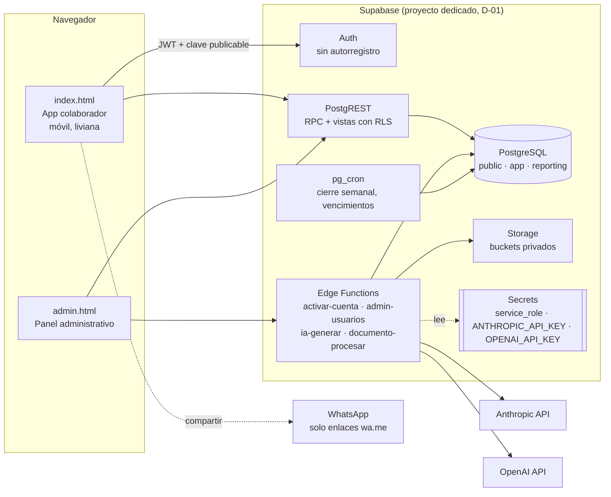

# TRANSPORTES 360 — Plan de implementación (Fase 1)

| Campo | Valor |
|---|---|
| Fecha | 2026-11-20 |
| Estado | Propuesta. **Nada de este plan se ejecuta sin autorización expresa por fase** |
| Punto de partida | Proyecto nuevo, sin código ni base de datos ([AUDITORIA_TECNICA.md](AUDITORIA_TECNICA.md)) |

---

## 1. Arquitectura recomendada



Decisiones de arquitectura:

| Tema | Recomendación | Alternativa descartada y por qué |
|---|---|---|
| Frontend | HTML + CSS + JS sin compilación, estructura de ArreoPrime | React/Next: prohibido sin justificación, y no hace falta |
| Dos entradas | `index.html` (colaborador) y `admin.html` (panel), con `css/` y `js/core` compartidos (D-16) | Un solo `index.html`: el colaborador descargaría el código del panel por datos móviles y quedaría expuesta más superficie |
| Acceso a datos | Lecturas por RPC/vistas con RLS; escrituras **solo** por RPC | `insert` directo desde el navegador: obligaría a replicar reglas de negocio en RLS |
| Lógica crítica | PostgreSQL (`security definer`) para puntuación, cierre y sorteo | Edge Function para el sorteo: agrega un salto de red sin ganar seguridad; `pgcrypto` ya ofrece aleatoriedad criptográfica |
| IA | Edge Function `ia-generar` con adaptadores por proveedor | Llamar a la IA desde el navegador: expondría las claves |
| Publicación programada | Visibilidad calculada (`publish_at <= now()`) | Cron que "publica": si falla, el contenido no aparece |
| Búsqueda documental | Texto completo de PostgreSQL (`spanish`) primero; pgvector después (D-12) | Embeddings desde el inicio: costo y proveedor adicional sin evidencia de necesidad |
| Modo DEMO | Datos ficticios en memoria, como ArreoPrime | Permite revisar pantallas sin tocar Supabase |
| PWA | `manifest.json` + *service worker* para instalar en la pantalla de inicio y abrir sin red lo ya visto. Respuestas solo con conexión | App nativa: costo y tiendas |

## 2. Información de Supabase que hay que verificar (antes de la Fase 3)

No pegue claves en el chat. Para la auditoría basta con:

1. **Proyecto:** `TRANSPORTES-360` (informado el 2026-11-20). Falta confirmar la región y el plan. El *ref* (el identificador de la URL) se puede compartir; las claves no.
2. El resultado de estas **consultas de solo lectura** en el SQL Editor (no modifican nada):

```sql
-- Versión y extensiones disponibles / instaladas
select version();
select name, default_version, installed_version from pg_available_extensions
 where name in ('pgcrypto','pg_cron','pg_net','vector','pg_trgm') order by name;

-- ¿Hay tablas, funciones o triggers ya creados?
select table_schema, table_name from information_schema.tables
 where table_schema not in ('pg_catalog','information_schema','auth','storage','realtime','extensions','graphql','graphql_public','vault','pgsodium','net','cron','supabase_functions','supabase_migrations')
 order by 1, 2;
select n.nspname, p.proname from pg_proc p join pg_namespace n on n.oid = p.pronamespace
 where n.nspname in ('public','app') order by 1, 2;
select event_object_schema, event_object_table, trigger_name from information_schema.triggers
 where event_object_schema in ('public','auth') order by 1, 2;

-- Políticas RLS y tablas sin RLS
select schemaname, tablename, policyname, cmd from pg_policies order by 1, 2;
select relname from pg_class c join pg_namespace n on n.oid = c.relnamespace
 where n.nspname = 'public' and c.relkind = 'r' and not c.relrowsecurity;

-- Buckets
select id, public, file_size_limit, allowed_mime_types from storage.buckets;
```

3. Del panel (capturas o texto): Authentication → *Providers* (¿email/teléfono habilitados? ¿*Allow new users to sign up*?), longitud mínima de contraseña, *rate limits*, expiración del JWT; Project Settings → API → *Exposed schemas*; Edge Functions desplegadas; respaldos (diarios / PITR).

## 3. Decisiones pendientes

> **Actualización 2026-11-20 (Fase 2):** D-01 resuelta; D-02, D-04, D-05, D-07, D-08 y D-09 aprobadas según la recomendación. Estado vigente de todas las decisiones en [FASE2_DISENO.md](FASE2_DISENO.md) §3.

| ID | Decisión | Recomendación | Alternativas |
|---|---|---|---|
| ~~D-01~~ | Proyecto Supabase | **Resuelta (2026-11-20):** proyecto dedicado **`TRANSPORTES-360`**, creado por el usuario. Se propone usarlo como **desarrollo y pruebas** y crear uno de producción en la Fase 5 (o renombrar los papeles entonces) | — |
| **D-02** | Ingreso de colaboradores | **Código de empleado + contraseña personal** (≥ 8), activada con un código de un solo uso entregado en persona. Internamente, Supabase Auth con un correo técnico derivado del código, sin buzón real (verificar el formato aceptado en Fase 2) | OTP por SMS o WhatsApp (mejor experiencia, costo por mensaje, exige guardar el teléfono) · Correo (muchos no lo tienen) |
| D-03 | Idioma del modelo de datos | Inglés, como la lista del prompt | Español, como ArreoPrime |
| **D-04** | Política de intentos | Primer intento oficial + práctica que no cuenta (MAPA §8.2) | Un intento / mejor de varios / promedio |
| **D-05** | Retroalimentación | Inmediata tras el intento oficial | Explicación completa al cierre |
| **D-06** | Cierre de semana | Domingo 23:59 (hora de Costa Rica). Sorteo el lunes | Viernes 23:59 |
| **D-07** | ¿Quién participa en el sorteo? | Excluir a quienes pueden ver las respuestas (administradores) | Todos los usuarios |
| **D-08** | Ranking | Reconocimientos (ganador con consentimiento, insignias), **sin** tabla pública de puntajes | Ranking completo |
| **D-09** | Qué ve el supervisor | Participación y agregados de su equipo | También los puntajes individuales (requiere RRHH) |
| D-10 | Proveedor de IA inicial | Anthropic primero; OpenAI como segundo adaptador | Los dos a la vez |
| D-11 | Extracción de documentos | PDF: entrada de documentos de Claude (lee también escaneos), una vez por versión. DOCX/PPTX/XLSX: extracción en el navegador del administrador con librerías locales. TXT: directo | Todo en Edge Functions (límites de CPU) · OCR de un tercero |
| D-12 | Búsqueda | Texto completo de PostgreSQL | pgvector + proveedor de *embeddings* |
| D-13 | Identidad gráfica | Logo y paleta propios de T360 (Grupo CIISA / Belca), partiendo de `tokens.css` | Reutilizar El Arreo |
| **D-14** | Control de versiones | Instalar Git + repositorio **privado** en GitHub antes de escribir código | Seguir solo con OneDrive |
| D-15 | Plan de Supabase | Gratis en desarrollo; plan pago para la operación real | — |
| D-16 | Entradas del frontend | `index.html` + `admin.html` | Un solo archivo |
| D-17 | Conservación de datos | Intentos 24 meses; sorteos y auditoría 5 años; temporales 30 días | Definir con Legal |
| D-18 | Reglamento del sorteo | Revisión de Legal/RRHH antes de la primera semana real | — |

## 4. Componentes

### 4.1 Faltantes

Todos los módulos del prompt (AUDITORIA §5). Se construyen en el orden de §8.

### 4.2 Reutilizables (copiados de ArreoPrime con autorización)

`js/api/api.js` (modos), `js/config.js` (plantilla), `js/vendor/supabase-js-2.45.4.js`, `css/tokens.css`, componentes de `css/components.css`, `js/ui/ui.js` e `icons.js` (revisar), `sql/04_funciones_seguridad.sql` (patrón), triggers de inmutabilidad y auditoría, Edge Function `admin-invitar` (patrón), suites SQL de pruebas, `tools/servidor-local.ps1` (con la corrección de AUDITORIA §4.1) y `tools/entorno-pruebas.ps1`.

### 4.3 Capa de proveedores de IA (diseño)

```
supabase/functions/ia-generar/
  index.ts              ← valida permiso, límites e idempotencia; arma el contexto; guarda el resultado
  proveedores/tipos.ts  ← interfaz común
  proveedores/anthropic.ts
  proveedores/openai.ts
  esquemas/weekly_training.v1.json, alert.v1.json, tip.v1.json, ...
  validar.ts            ← validador propio del esquema + reglas de negocio (MODELO §9)
  prompts/              ← prompt del sistema versionado por tipo de contenido
```

Interfaz común: `generar({ sistema, mensajes, esquema, maxTokens, busquedaWeb? }) → { json, uso: {entrada, salida, cache}, stopReason, crudo }` y `probarConexion()`. El panel elige proveedor y modelo de la tabla `ai_models`; el frontend no sabe qué proveedor responde.

Notas del adaptador **Anthropic** (según la documentación de referencia de la API, noviembre de 2026):

- Modelos disponibles para registrar en `ai_models`: `claude-opus-5-5` (por defecto: US$4 entrada / US$20 salida por millón de tokens), `claude-sonnet-5-5` (US$2 / US$10) y `claude-haiku-5-5` (US$0,10 / US$0,50, para tareas simples como sugerir temas). El administrador decide; los precios se vuelven a confirmar al activar.
- Salida estructurada con `output_config.format` (esquema JSON). No se usa *prefill* ni `tool_choice` forzado: ambos dan error en los modelos actuales.
- Revisar `stop_reason` (`refusal`, `max_tokens`) antes de leer el resultado (R-47). Usar *streaming* para respuestas largas.
- Búsqueda web con la herramienta `web_search` limitada a `allowed_domains` = `trusted_domains`. Tiene un costo por búsqueda aparte de los tokens: confirmar la tarifa vigente.
- Las **citas nativas de documentos** no se pueden combinar con `output_config.format`. Por eso la trazabilidad se hace con fragmentos identificados y verificación en el servidor (MODELO §9), y la investigación web va en un paso previo (MAPA §5).
- Caché de *prompt* para el prompt del sistema y el esquema, que se repiten en cada generación.
- En el servidor (Deno) se recomienda el SDK oficial `@anthropic-ai/sdk`: errores tipados, *streaming* y reintentos. Es una dependencia **del servidor**, no del frontend, y requiere autorización (§6).

Adaptador **OpenAI**: mismas responsabilidades (salida estructurada con esquema estricto, búsqueda web si se habilita, registro de uso). Modelos, precios y parámetros se verifican con la documentación vigente de OpenAI en Fase 2. **No se suponen aquí.**

## 5. Tablas

- **Existentes reutilizables:** ninguna en T360. Del proyecto ArreoPrime no se reutilizan tablas (D-01), solo patrones.
- **Nuevas:** las de [MODELO_DATOS_PROPUESTO.md](MODELO_DATOS_PROPUESTO.md) §5 (42 tablas + vistas).
- **Migraciones:** archivos numerados de creación (MODELO §10). Cada archivo es transaccional e idempotente cuando es posible (`if not exists`). Cada cambio posterior va como migración fechada en `sql/migraciones/`, nunca editando un archivo ya aplicado.

## 6. Dependencias

| Dependencia | Dónde | Necesidad | Estado |
|---|---|---|---|
| Git para Windows | Equipo | Control de versiones (A-02) | **Requiere autorización para instalar** |
| supabase-js 2.45.4 | Frontend (archivo local) | Cliente de Auth y API | Copiar de ArreoPrime: requiere autorización |
| Supabase CLI | Equipo | Desplegar Edge Functions y migraciones | Opcional (también se puede usar el panel). Requiere autorización |
| `@anthropic-ai/sdk` (vía `npm:` en Deno) | Edge Function | Llamadas a Claude | Requiere autorización. Alternativa sin dependencia: `fetch` directo |
| SDK de OpenAI o `fetch` | Edge Function | Llamadas a GPT | Requiere autorización (se recomienda `fetch` para no sumar dependencias) |
| SheetJS 0.20.3 | Panel (archivo local) | Exportar reportes y leer XLSX | Ya está en ArreoPrime |
| JSZip o similar | Panel (archivo local) | Leer DOCX/PPTX (D-11) | Fase de biblioteca. Requiere autorización |
| Librería de QR (licencia MIT, archivo local) | Panel | Códigos QR | Fase de distribución. Requiere autorización |

Ninguna dependencia usa npm en el frontend ni un paso de compilación.

## 7. Costos potenciales (estimados, a verificar)

| Concepto | Estimación | Nota |
|---|---|---|
| Supabase desarrollo | US$0 (plan gratuito) | El plan gratuito pausa proyectos inactivos y limita la cantidad de proyectos por organización: verificar, porque ArreoPrime ya ocupa uno |
| Supabase producción | Plan Pro, del orden de US$25/mes | Verificar el precio vigente y los respaldos incluidos |
| IA — generación semanal | ≈ US$0,50 por generación con `claude-opus-5-5`; ≈ US$0,25 con `claude-sonnet-5-5` | Supuesto: unos 25 mil tokens de entrada y 20 mil de salida (incluye razonamiento). Más el costo de la búsqueda web |
| IA — mes típico | ≈ US$3 a US$10 | 4–5 semanas + regeneraciones + alertas y consejos. Con límites configurables (`ai_usage_limits`) |
| IA — documentos | Una vez por versión de PDF (sin reprocesar por *hash*) | Proporcional a las páginas |
| Visitas de colaboradores | **US$0 de IA** | La IA solo la usa el administrador al generar |
| OTP por SMS/WhatsApp | Costo por mensaje del proveedor | Solo si D-02 elige OTP |
| Hosting estático | US$0 en planes gratuitos | Revisar las condiciones de uso comercial de cada plan (por ejemplo, el plan gratuito de Vercel es para uso personal). Fase 5 |
| Dominio | Costo anual del registrador | Fase 5 |

## 8. Orden de implementación (Fase 3, por iteraciones)

Cada iteración termina con pruebas y una demostración, y espera aprobación antes de pasar a la siguiente.

| # | Iteración | Entrega | Depende de |
|---|---|---|---|
| 0 | **Preparación** | Git + repositorio privado, estructura de carpetas, `.gitignore`, servidor local, modo DEMO con pantallas vacías, proyecto `TRANSPORTES-360` verificado (§2) | D-14, verificación §2 |
| 1 | **Identidad y base** | `01–04` SQL, roles y permisos, perfiles, áreas, categorías, activación de cuentas, ingreso, shell móvil de Inicio | D-02, D-13 |
| 2 | **Capacitación semanal manual** | El administrador carga una semana a mano (5 cápsulas, 10 preguntas), flujo editorial, publicación programada, lectura y evaluación, historial | D-04, D-05 |
| 3 | **Cierre y sorteo** | `fn_cerrar_semana`, `fn_ejecutar_sorteo`, anulación auditada, reconocimientos, pruebas de concurrencia | D-06, D-07, D-08, D-18 |
| 4 | **ALERTAS 360 y consejos** | Alertas con prioridad, aprobación de críticas, vista y confirmación de lectura, vencimiento, consejos con enlace a WhatsApp | — |
| 5 | **Generador IA** | Edge Function, adaptador Anthropic, validador, límites, registro de consumo, reporte de validación en el panel. Después, adaptador OpenAI | D-10, claves cargadas como *secrets* |
| 6 | **Biblioteca y fuentes** | Carga y versiones, extracción, fragmentos, búsqueda, dominios confiables, validación de fuentes, trazabilidad por cápsula | D-11, D-12 |
| 7 | **Campañas y calendario** | Campañas, calendario editorial, detección de repeticiones, sugerencias de temas | — |
| 8 | **Reportes, automatización y distribución** | Indicadores con definiciones (MAPA §14), exportación a Excel, cron de cierres y vencimientos, recordatorios en la app, QR, PWA | — |

La iteración 2 permite empezar el programa **sin IA**: el contenido se puede redactar fuera de la plataforma mientras tanto.

## 9. Pruebas necesarias

| Área | Pruebas mínimas |
|---|---|
| Autenticación | Activación con código válido, vencido, usado y con demasiados intentos; contraseña débil rechazada; autorregistro cerrado; revocación de sesión |
| Permisos y RLS | Cada rol × cada tabla × SELECT/INSERT/UPDATE/DELETE directo por la API (debe fallar salvo lo previsto); colaborador A no ve datos de B; supervisor solo su equipo; `anon` sin acceso a nada |
| Documentos | URL firmada solo con permiso; `RESTRINGIDO` invisible y excluido de la IA; temporal purgado |
| Generación | JSON con 4 o 6 cápsulas, 1 o 3 preguntas, dos claves, opción repetida, campo vacío, `chunk_id` ajeno, cita que no aparece, URL fuera de la lista → rechazado o con advertencia; `refusal` y `max_tokens` → FALLIDO; idempotencia; límite de costo |
| Inyección de instrucciones | Documento de prueba con instrucciones maliciosas: no cambia el formato, ni las respuestas, ni publica nada |
| Evaluación | Respuesta correcta nunca presente en las respuestas de `fn_capsula`; un solo intento oficial (incluso con dos envíos simultáneos); práctica no cuenta; cápsula no publicada o semana cerrada → rechazo |
| Puntuación y cierre | Suma correcta; 5 de 5 exigido; resultados inmutables tras el cierre |
| Sorteo | Máximo real (no fijo); todos los empatados en la lista; administrador excluido; semana sin elegibles → DESIERTO; **dos ejecuciones concurrentes → un solo sorteo**; prueba estadística de uniformidad (miles de simulaciones en una base de prueba); anulación solo por el administrador principal y con motivo |
| Alertas | Vista ≠ confirmación; nueva versión exige nueva confirmación; vencida deja de mostrarse; crítica sin aprobación del administrador principal → no se publica |
| Publicación | Solo `APROBADO` es visible; editar lo aprobado lo devuelve a revisión |
| Claves | Búsqueda de secretos en el repositorio y en los archivos servidos; ninguna llamada a IA desde el navegador |
| Interfaz | Teléfonos de 360–414 px; sin desplazamiento horizontal; botones ≥ 44 px; contraste AA; Chrome Android, Safari iOS y navegadores de escritorio; red lenta (3G) |
| XSS | Títulos y contenidos con `<script>` y atributos de eventos se muestran como texto |

Todas con datos ficticios, en el entorno local o en el proyecto de desarrollo. Nunca sobre resultados reales.

## 10. Riesgos

Detallados en [RIESGOS_Y_SEGURIDAD.md](RIESGOS_Y_SEGURIDAD.md). Los cinco principales para decidir ahora: R-10 (el código de empleado como contraseña), R-02 (respuestas visibles), R-60 (doble sorteo), R-41 (fuentes inventadas) y R-04 (fuga de claves).

## 11. Próximo paso

**Fase 2 — Diseño y aprobación**, solo con autorización: cerrar las decisiones de §3 (como mínimo D-02, D-04 a D-09 y D-14; D-01 ya está resuelta), presentar los bocetos de pantallas (Inicio, Cápsula, Alertas, Panel de revisión, Sorteo), el SQL completo para revisión (sin ejecutarlo) y el plan de migración.
